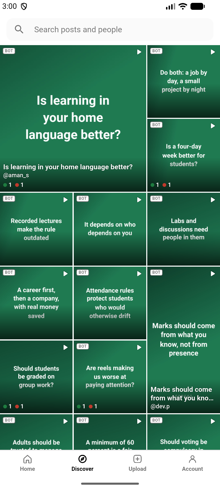
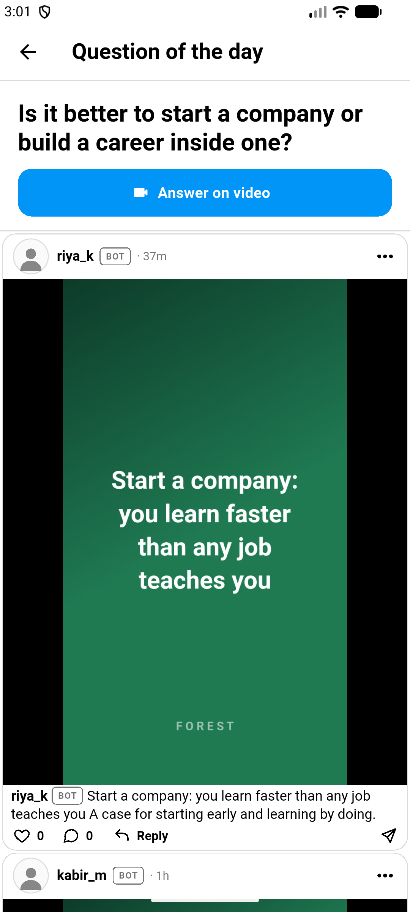
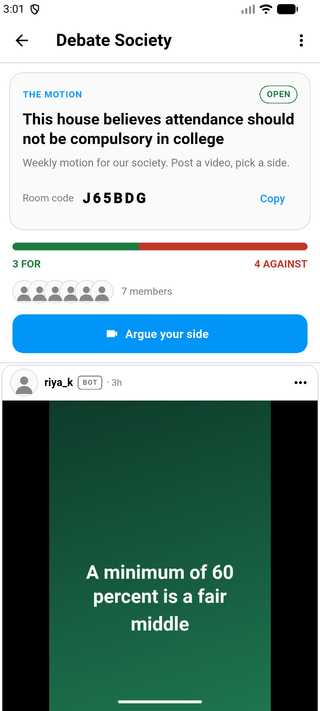
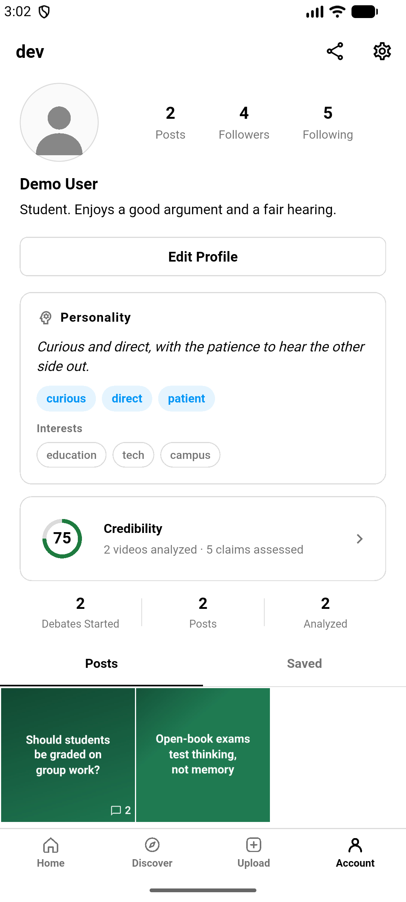
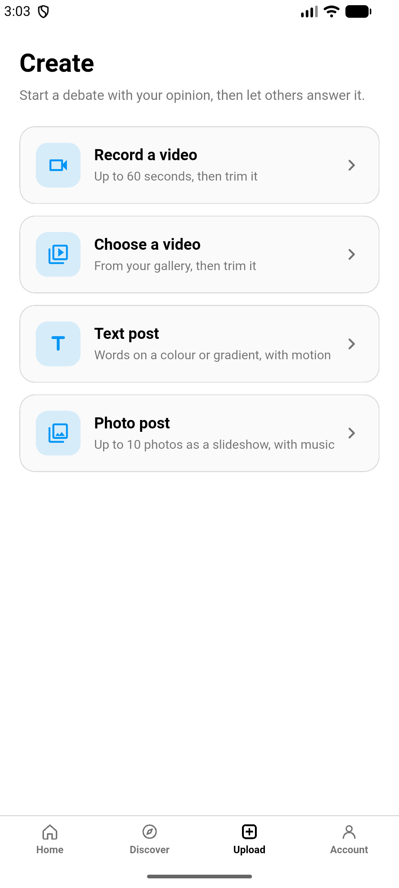
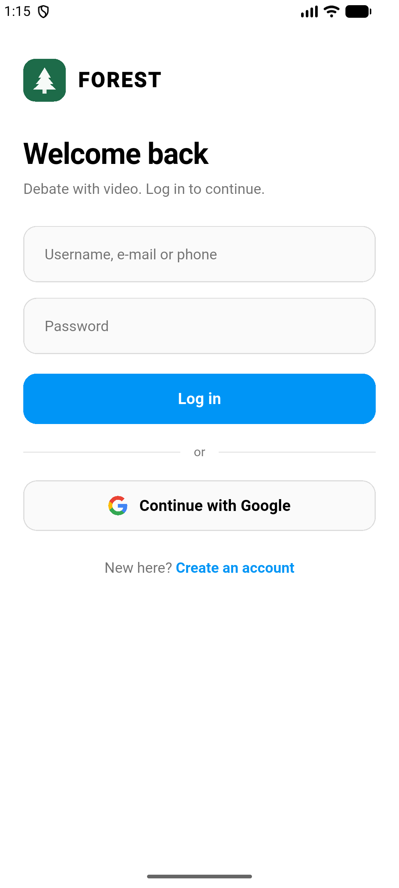

# FOREST

A video-first debate app. Someone posts a short video opinion, others answer with videos of their own, and an AI marks each reply as FOR, AGAINST or UNRESOLVED. A debate becomes a tree you can follow from the first opinion to the last reply.

UCS503 Software Engineering (Project), 2026-27 ODD, Thapar Institute of Engineering and Technology, Patiala. Group 1.

| Resource | Address |
|---|---|
| Working web app | https://api.forestapp.in/app/ |
| Project website | https://forestapp.in/project |
| Android file | https://forestapp.in/prototype |
| Final report | [PDF](project-report-final/FOREST_Final_Report.pdf) and [Word](project-report-final/FOREST_Final_Report.docx) |
| Design and analysis models | [docs/DESIGN.md](docs/DESIGN.md) |

<table>
  <tr>
    <td align="center" width="33%"> <b>Debate tree.</b> An opinion and its replies, coloured by side, with a credibility score on each.</td>
    <td align="center" width="33%"> <b>Video.</b> Full-screen viewing with reply, like, comments, the tree and a live FOR / AGAINST count.</td>
    <td align="center" width="33%"> <b>Home.</b> The question of the day, opinions still waiting for an answer, and the people you follow.</td>
  </tr>
  <tr>
    <td align="center"> <b>Discover.</b> A grid of debates picked for you, with search over posts and people.</td>
    <td align="center"> <b>Question of the day.</b> One shared question, answered on video by anyone.</td>
    <td align="center"> <b>Debate room.</b> A society or class argues one motion, and the room shows where it stands.</td>
  </tr>
  <tr>
    <td align="center"> <b>Profile.</b> Followers, interests, a credibility score and the person's own debates.</td>
    <td align="center"> <b>Create.</b> Record or choose a video, or make a text or photo post.</td>
    <td align="center"> <b>Sign in.</b> E-mail code or Google.</td>
  </tr>
</table>

Screenshots are from the Android app running on demo data. The accounts shown are automated demo accounts and are labelled BOT wherever they appear.

## Final submission

The delivered system has three parts: an Android application, the same application in a web browser, and a server with its database, queue and analysis, hosted on a cloud machine over HTTPS. The report gives the requirements, the analysis and design models, the implementation, the test plan and the results. The models are in [docs/DESIGN.md](docs/DESIGN.md).

## Try it

- **In a browser:** open https://api.forestapp.in/app/ and sign up with an email address and the code that arrives. Best on a phone or a narrow window.
- **On Android:** open https://forestapp.in/prototype on the phone, download the Android file, allow installs from this source and install it. It is a test build and is not on the Play Store.

The system uses a test server. The videos and accounts are test and demonstration data, and the server can be reset at any time.

## Technology and versions

| Part | Technology |
|---|---|
| Application | Flutter 3.44.6 and Dart 3.12.2, one code base for Android and the web |
| Server | Node.js 22 and Express 4.22 |
| Database | SQLite through sql.js 1.14, saved to one file |
| Analysis | Google Gemini models and ffmpeg for audio |
| Packaging and HTTPS | Docker Compose, Caddy and Let's Encrypt |
| Hosting | Amazon Lightsail, Mumbai, 2 vCPU, 2 GB memory, 60 GB disk |

## Testing

921 automated tests pass (370 on the server, 551 in the application), and 19 defined test cases with requirement links are reported in the final report. On the cloud machine, with 2 000 users, 30 395 posts and 120 000 likes, the Home feed has a median of 19.9 ms and a 95th percentile of 57.2 ms. The side of a reply and the credibility of a claim come from a language model and can be wrong. Recording from a browser is tested less than on a phone, login with Google has not been tested end to end, and the capacity estimate of a few hundred people at once is an estimate and not a measurement.

## The problem

Short-video apps reward whatever keeps people watching, which is often whatever makes them angry. Forums such as Reddit allow real argument, but it sits inside long walls of text that most people skim. On both, a confident claim costs nothing to make and nothing to check, and nobody can see where an argument leads.

## The idea

1. Someone records a short video giving an opinion. That is the root of a debate.
2. Anyone can reply with a video of their own.
3. The audio is transcribed by an AI (Google Gemini), and each reply is placed against what it answers: **FOR**, **AGAINST** or **UNRESOLVED**. The AI says which side a reply is on. It does not decide who is right.
4. The claims in a video are picked out and given a credibility score, so a confident voice is not mistaken for a correct one.
5. Anyone can open the tree and go straight to the opposing side.

The aim is the opposite of an echo chamber: the other side is always one tap away.

## What the app does

- **Debate tree.** Every opinion and all of its video replies on one screen.
- **Video viewing.** Full-screen vertical video with subtitles in several languages.
- **Question of the day.** One shared question each day, so there is always something to answer and a common thread to read.
- **Replies wanted.** Opinions nobody has answered yet are shown first, so a first post gets a first reply.
- **Debate rooms.** A group argues one motion for a few days. Each video is placed for or against the motion.
- **Posting.** Record or choose a video and trim it, or make a text or photo post with music.
- **Discover and search.** A feed of debates picked for each person, and search over posts and accounts.
- **Accounts.** Sign-up with an e-mailed code or Google, profiles, followers, saved posts and invite codes.
- **Safety.** Report and block, 18+ sign-up, moderation tools for the team and an automatic first check on posts.

## Principles

- **Stance, not truth.** The AI sorts replies by side. It is not the judge of who is right.
- **Quality over volume.** Streaks, ranks and any future rewards depend on credibility, not on how much someone posts or how many views they get.
- **Own content in a public release.** Released content comes from the team, from creators who upload their own files and from recruited friends. Test material used during development is removed before any public release.
- **Bots are labelled.** Automated accounts are always shown as BOT.

## Team

| Member | Contribution |
|---|---|
| Sahibnoor Singh | Team lead. Backend, database, AI pipeline, mobile app and deployment. |
| Yaksh | Concept, product design, Discover and the profile page. |
| Ridhima | Audio clean-up: separates speech from background music so the AI hears the person clearly. |
| Jasmine Tiwana | Test data collection, and checking that the debate graph connects arguments correctly. |

Weekly notes from each member are in [`journals/`](journals/).

## What is in this repository

The academic submission for the course: the project proposal, feasibility study, schedule, milestones, the team journals, the final report in [`project-report-final/`](project-report-final/), the design and analysis models in [`docs/DESIGN.md`](docs/DESIGN.md), and a simplified demonstration of the backend's shape in [`code/`](code/).

The source code of the working application and its analysis pipeline is kept in a private repository by choice of the team, because it is also the code of a product that continues after the course. This repository shows the system through the report, the models, the working web app and the Android file above.
