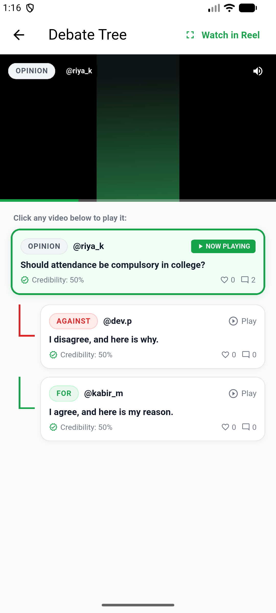
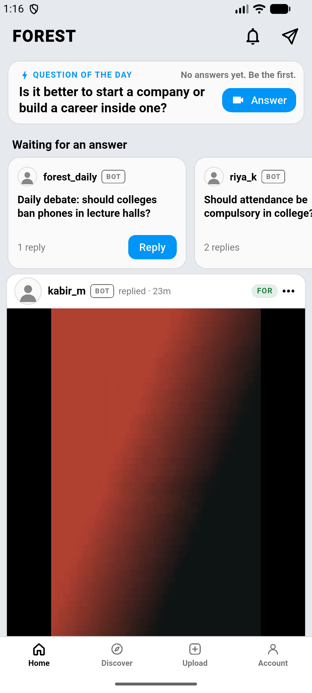
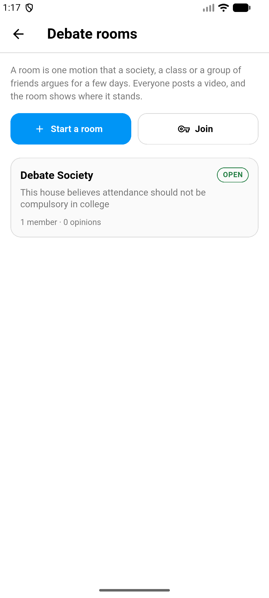

# FOREST

**A video-first debate app. People answer an opinion with a video, and an AI maps every reply as FOR, AGAINST or UNRESOLVED, so a debate becomes a tree you can follow instead of a feed you scroll.**

*UCS503 Software Engineering (Project), 2026-27 ODD, Thapar Institute of Engineering and Technology, Patiala. Group 1.*

  
  
  
  

Screenshots are from the Android app running on demo data. The videos are generated placeholders, and every account shown is an automated demo account, labelled **BOT** wherever it appears.

---

## The problem

Short-video apps reward whatever keeps people watching, which is usually whatever makes them angry. Text forums such as Reddit allow real argument, but it is buried in long walls of text that most people skim. In both, a bold claim costs nothing to make and nothing to check, and nobody can see where an argument actually leads.

## The idea

FOREST turns a conversation into a **tree of videos**:

1. Someone records a short video giving an opinion. That is the **root** of a debate.
2. Anyone can reply with a video of their own.
3. The audio is transcribed by an AI (Google Gemini) and each reply is placed against what it answers: **FOR**, **AGAINST** or **UNRESOLVED**. The AI does not decide who is right. It only reports which side a reply is on.
4. The claims in a video are picked out and given a **credibility score**, so a confident voice is not mistaken for a correct one.
5. Everyone can open the tree, jump straight to the opposing side, and hear the other argument in a tap.

The aim is the opposite of an echo chamber: the app is built so that the other side is always one swipe away.

## What the app does

| | |
|---|---|
| **Debate tree** | Every opinion and all of its video replies on one screen, coloured by side, with credibility shown on each. |
| **Reel-style viewing** | Full-screen vertical video with Reply, Like, Comments, Tree and Send in reach, and a live FOR / AGAINST count. |
| **Question of the day** | One shared question each day that anyone can answer on video, which gives new people something to say and everybody a common thread. |
| **Replies wanted** | Opinions that nobody has answered yet are surfaced, so a first post gets a first reply. |
| **Debate rooms** | A society, a class or a group of friends argues one motion for a few days. Each video is placed for or against the motion and the room shows where it stands. |
| **Accounts and profiles** | Sign-up with an e-mailed code or Google, a personal profile with a credibility summary, followers, saved posts and a short bio. |
| **Safety** | Report and block, 18+ sign-up, moderation tools for the team, and an automatic first-pass check on posts. |
| **Honest labelling** | Automated accounts are always shown as **BOT**. They are never presented as real people. |

## Principles we hold ourselves to

- **Stance, not truth.** The AI sorts replies by side. It is not an authority on who is right.
- **Quality over volume.** Streaks, ranks and any future creator rewards depend on credibility, not on how much someone posts or how many views they get.
- **No borrowed content.** We do not copy or re-host videos from other platforms. Content comes from our own recordings and from people who upload their own.
- **Bots are labelled.** Always.

## Team

| Member | Contribution |
|---|---|
| **Sahibnoor Singh** | Team lead. Backend architecture, database, deployment. |
| **Yaksh** | Concept, product design and the mobile app. |
| **Ridhima** | Audio clean-up: separates speech from background music so the AI hears the person clearly. |
| **Jasmine Tiwana** | Test data collection and checking that the debate graph connects arguments correctly. |

Each member's weekly notes are in [`journals/`](journals/).

## What is in this repository

This repository is the **academic submission** for the course. It holds the project proposal, feasibility study, schedule, milestones and the team journals, along with a deliberately simplified demonstration of the backend's shape in [`code/`](code/).

The working application, its AI pipeline and its tuning are developed privately and are not part of this repository.

## Status

| Milestone | State |
|---|---|
| Backend, dataset, AI stance classification | Done |
| Flutter mobile app: accounts, video feed, debate tree, question of the day, rooms | Built and in internal testing |
| Student beta (about 100 users) | Next |
| Final report and presentation | March 2027 |

The full plan is in [`docs/MILESTONES.md`](docs/MILESTONES.md).
