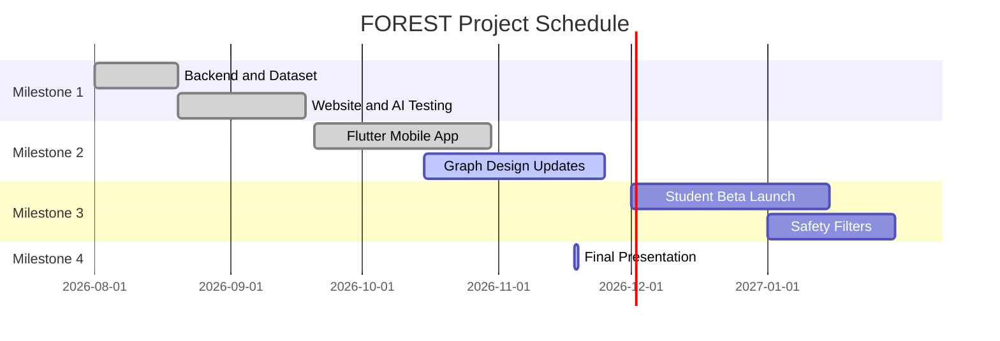

# Milestone and Launch Plan
## Project FOREST

### 1. Project Overview
Our project development is divided into four main phases. We start with a basic website and AI testing, and eventually build a full mobile app that real students can use. We make sure each phase is fully working before moving to the next one.

### 2. Milestone 1: Core Website and AI Testing
**Status:** Completed
**Target Date:** September 18, 2026

In this phase, we focused on getting the core technology to work.
* We designed the main database and backend system.
* We gathered a small dataset of 20 political videos to test our idea manually.
* We connected the Gemini API so it can read video audio and decide if a video is FOR or AGAINST a topic.
* We launched a basic testing website where users can upload a transcript and see the graph build live.

### 3. Milestone 2: Mobile App and Better Graphs
**Status:** Mostly done, in internal testing
**Target Date:** November 25, 2026

Now that the website works, we need to make it accessible for normal users on their phones.
* We built a mobile application using Flutter. Users sign up with an e-mailed code or Google, record videos from their camera, and reply to each other with video.
* The debate tree shows an opinion and all of its replies on one screen, coloured FOR or AGAINST, with a credibility score on each.
* We added a question of the day, a list of opinions still waiting for a first reply, and debate rooms where a society or class argues one motion.
* Automated demo accounts are always labelled BOT in the app.
* Still to do: a community vote for replies the AI cannot place, for example sarcasm.

### 4. Milestone 3: Beta Launch
**Status:** Planned
**Target Date:** January 30, 2027

This is our testing phase where we share the app with real people to see if it actually stops echo chambers.
* We will invite about 100 university students to download the app and post debate videos.
* We will track how people use the app to make sure it shows them different opinions, not just the ones they agree with.
* We will add an automatic safety filter to block bad language or inappropriate videos.

### 5. Milestone 4: Final Presentation
**Status:** In progress

The final presentation of the project to the evaluation panel.
* Present the working Flutter app: video feed, debate tree, question of the day and debate rooms.
* Present the AI pipeline that places each reply as FOR, AGAINST or UNRESOLVED.
* Submit the report and the team journals.

### Visual Schedule

